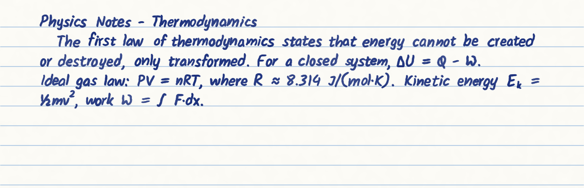
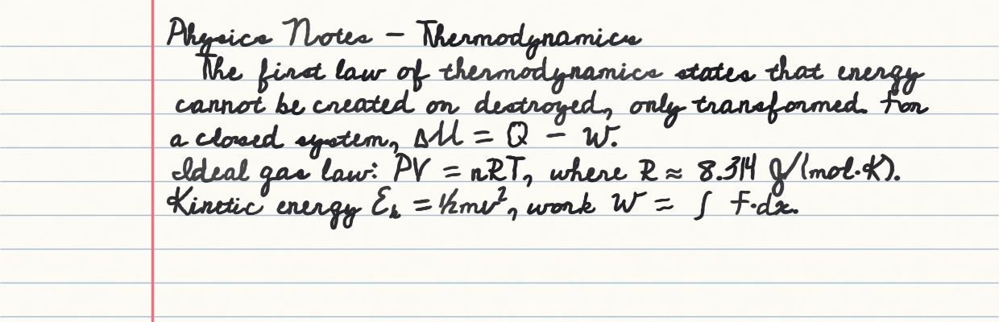

# Text2Hand

### Personalised Handwriting Synthesis from a Single Page via Stroke-Level Modelling

Turn typed text into realistic handwritten **A4 PDF and DOCX** documents: not the
perfect, repeated letters of a "handwriting font", but writing with the imperfections of a
real pen. Baselines drift, letters vary in shape and slant, spacing is uneven, pressure
and ink change, and the hand gets a little tired towards the bottom of the page. It can
also **learn your own handwriting** from one photographed page.




## Features

- **Print and joined-cursive** styles (4 built-in hands), or **your own handwriting**
- Every letter is unique: elastic warp, rotation, scale, slant, baseline and pressure
  variation, with **Neat / Natural / Hurried** messiness and reproducible seeds
- **Cursive joins** are redrawn smoothly between letters after variation, so words stay
  connected
- **Pages**: blank, wide / college / narrow ruled, ruled with margin, or **your own scanned
  page** (PDF or image). Printed lines and margins are detected automatically (with a manual
  calibration fallback), and text sits **on the lines**
- English letters, digits, punctuation and **maths/science symbols** (± × ÷ ≈ ≠ ≤ ≥ ∞ √ ∑
  ∫ ∂ ∆ ∇ ∈ ∀ ∃ → ⇒ α β γ θ π ω ° …), plus `x^2`, `x^{n+1}`, `H_2O`, `a_{ij}`, `x_n`
- **Learn your handwriting**: upload a handwritten page plus the text you wrote; the app
  finds lines, words and letters, checks them with a small neural network, and lets you
  review the result before saving a profile. Add more pages over time for more variety
- Local **web app** (Gradio) and a **CLI**

## How it works

```
text ──► layout engine ──► glyph source ──► imperfection engine ──► pen renderer ──► PDF / DOCX
            ▲                (font or your      (per letter, word,       (variable-width,
     page template /          profile; symbol     line, page)              anti-aliased ink,
     scanned page             fallbacks)                                    multiply blend)
```

* Letters are stored as **centre-line pen strokes** (skeletons of font glyphs or of your
  handwriting), in x-height units, so every style shares one scale and can be re-drawn
  with any pen.
* **Learning your handwriting**: preprocess (perspective, ink vs. paper, remove printed
  rules) → find lines, baselines, x-height and slant → align written words with the typed
  text (dynamic programming) → cut words into letters (dynamic programming over cut
  points, guided by a CNN letter recogniser) → validate → skeletonise into strokes.
* **ML** (CPU only): a compact CNN recogniser trained on synthetic handwriting generated by
  the app's own imperfection engine from the bundled fonts, including a "not a letter"
  class of fragments. It guides segmentation and flags samples that don't look like their
  letter. No dataset download needed.

See [docs/DESIGN.md](docs/DESIGN.md) for the full method, evaluation and limitations.

## Setup (Windows)

```powershell
git clone https://github.com/DhruvAgarwalla/text2hand.git
cd text2hand
python -m venv .venv
.venv\Scripts\Activate.ps1
pip install -e ".[dev]"
# optional but recommended (improves learning your handwriting): CPU-only PyTorch
pip install torch --index-url https://download.pytorch.org/whl/cpu
```

macOS / Linux: use `source .venv/bin/activate`.

The command-line tool is available as both `handwriter` and `text2hand`.

A trained recogniser ships in `models/letter_recognizer.pt` (95% accuracy on held-out
synthetic letters). To retrain it (about 30 minutes on a laptop CPU):
`handwriter train-recognizer`.

### Quality check

`handwriter evaluate` measures every style:

| style | line fit* | worst | variation | legible (top-1) | s / A4 page |
|---|---|---|---|---|---|
| print | -0.04 | 0.08 | 0.017 | 97% | 2.1 |
| print-neat | -0.06 | 0.09 | 0.022 | 98% | 2.1 |
| cursive | -0.09 | 0.14 | 0.027 | 100% | 2.5 |
| cursive-school | -0.05 | 0.12 | 0.030 | 99% | 2.4 |

\*gap between each line's lowest ink and its rule, in x-heights (0 = resting on the line).
Legibility is read by the bundled recogniser, which was trained on these fonts, so it is an
upper bound.

## Usage

### Web app

```powershell
handwriter web
```

Open <http://localhost:7860>.
* **Write**: paste text, pick a handwriting style and page (or upload your own page), and
  adjust messiness, size, slant, spacing, ink and pen. Preview, then download the PDF or
  DOCX.
* **My handwriting**: write the suggested text (or anything) by hand, photograph it,
  upload it with the text you wrote, review the learned letters, and save a profile. It
  then appears in the Write tab's style list.

### Command line

```powershell
handwriter styles                                   # list styles, pages, inks
handwriter render notes.txt -o notes.pdf            # print style, college ruled
handwriter render notes.txt -o notes.docx --style cursive --page ruled-margin --ink black
handwriter render notes.txt -o out.pdf --background my_page.pdf --messiness 1.4 --seed 7
handwriter learn page.jpg --text page.txt --name me --style print --review sheet.png
handwriter render notes.txt -o mine.pdf --style profile:me
```

## Tips for learning your handwriting

* Write in your normal style with a dark pen; a sharp, evenly lit photo from straight
  above (or a scan) works best.
* The typed text must match what you wrote (line breaks don't matter).
* Use the suggested text for full coverage; letters you never wrote fall back to a built-in
  style, slanted to match yours.
* Check the review sheet and reject wrong samples (red ones are already rejected).
* Joined cursive is harder to cut into letters than print. Expect more rejected samples,
  and add a second page for better results.

## Project layout

```
src/handwriter/
  strokes/        skeleton extraction, glyph model, font sources, glyph sets
  imperfections/  variation parameters, smooth noise, per-letter variation, cursive joins
  layout/         text parsing (maths markup), line breaking, baselines, pages
  templates/      A4 templates, scanned-page import and line detection
  render/         pen and ink renderer
  export/         PDF and DOCX writers
  capture/        learn handwriting: preprocess, segment, align, letter cuts, profiles
  ml/             CNN letter recogniser, synthetic data, features
  app/            CLI and Gradio web app
assets/fonts/     bundled OFL / Apache handwriting and symbol fonts (licences included)
tests/            pytest suite
docs/DESIGN.md    design, method, evaluation and limitations
```

## Development

```powershell
pytest -q
ruff check .
```

## Privacy

Handwriting profiles (`profiles/`) are git-ignored and stay on your machine. The web app
runs locally; `--share` is off by default.

## Fonts

Kalam, Architects Daughter, Cedarville Cursive, Noto Sans and Noto Sans Math (SIL Open Font
License) and Homemade Apple (Apache 2.0), all from Google Fonts. Licence files are in
`assets/fonts/`.
